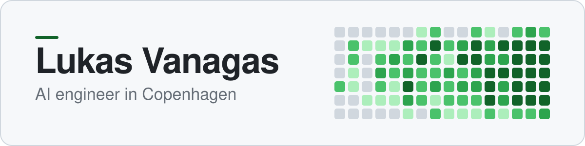
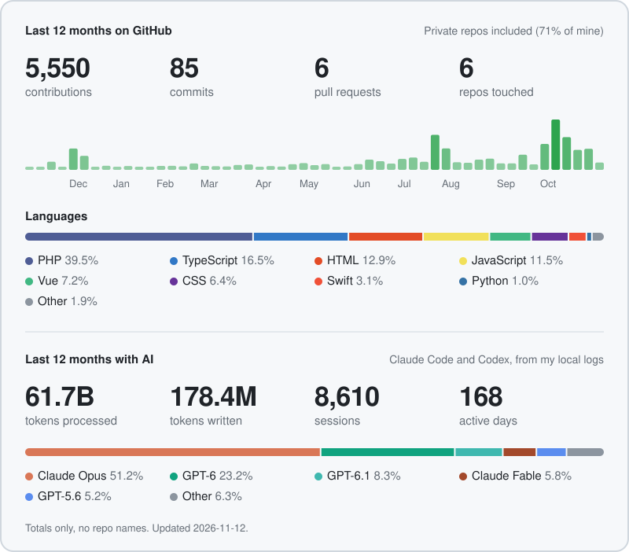

<picture>
  <source media="(prefers-color-scheme: dark)" srcset="./assets/banner-dark.svg">
  
</picture>

  <a href="https://lukasnotes.dk">Lukas' Notes</a> ·
  <a href="https://www.linkedin.com/in/luvan/">LinkedIn</a> ·
  Copenhagen, DK

Ten years of building for the web, now an AI engineer at Joe & The Juice. I build MCP servers, agent workflows and the internal tools around them, and I help the company get real value out of Claude.

Most of that work lives in private repos, so this page counts it for you.

<picture>
  <source media="(prefers-color-scheme: dark)" srcset="./assets/activity-dark.svg">
  
</picture>

### Now

- Shipping MCP servers and agent workflows at Joe & The Juice
- Rolling out Claude Enterprise across the company
- Building small tools on the side when something annoys me enough
<!-- TODO: add Deco here with a one-line description and link -->

### Recently shipped in public

- [**browser-chooser**](https://github.com/flexchar/browser-chooser) - a macOS link chooser that opens each link in the right Chrome, Edge or Safari profile. Swift.
- [**chemija-org**](https://github.com/flexchar/chemija-org) - Chemija.org rebuilt on Astro and Sanity, a Lithuanian chemistry information site.
- [**turso-sync**](https://github.com/flexchar/turso-sync) - syncs a libSQL or Turso database to a file, packaged as a Docker image.
- [**tiktoken-counter**](https://github.com/flexchar/tiktoken-counter) - OpenAI's tiktoken tokenizer as a standalone API.

### Writing

<!-- BLOG:START -->
- [Latest posts on Lukas' Notes](https://lukasnotes.dk/archive)
<!-- BLOG:END -->

The activity card and the post list refresh every Monday from a GitHub Action in this repo.
